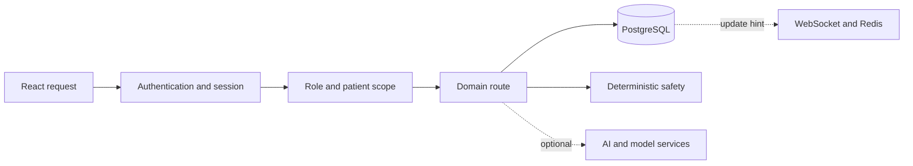

# Vitala API

FastAPI owns authentication, patient access, clinical records and research controls. PostgreSQL is the source of truth; the browser never decides whether a user may read a patient's data. Start with the [project setup](../README.md#run-locally) and [architecture guide](../docs/ARCHITECTURE.md).



## Code map

| Location | Responsibility |
| --- | --- |
| `main.py`, `config.py`, `database.py` | Application startup, settings and database sessions |
| `routes/` | Auth, patients, care, devices, alerts, administration and research APIs; see the [route guide](routes/README.md) |
| `access_control.py`, `auth_utils.py` | Patient access policy and token/session handling |
| `measurement_ingestion.py`, `early_warning.py`, `risk_assessment.py` | Observation validation, deterministic urgent checks and canonical assessment |
| `notification_broadcast.py`, `monitoring.py` | Durable notification updates and background monitoring |
| `ml_engine/` | Features, evaluation and artifact loading; see the [model guide](ml_engine/README.md) |
| `evaluation_suite/` | Synthetic research scenarios; see the [evaluation guide](evaluation_suite/README.md) |
| `alembic/` | Versioned schema migrations; see [migration guidance](MIGRATIONS.md) |
| `tests/` | API, access, safety and regression checks |

## Run locally

From `backend/`, create a Python 3.12 environment, install `requirements-dev.lock` with `--require-hashes`, and copy `.env.example` to `.env`. Supply a local PostgreSQL URL and unique signing secret. Then run:

```powershell
.\venv\Scripts\alembic.exe upgrade head
.\venv\Scripts\uvicorn.exe main:app --reload
```

`GET /health` checks liveness and `GET /ready` reports readiness. Interactive API docs are available at `/docs` in development. Never commit `.env` or copied research data.

## Verify changes

From the repository root, `python scripts/run-local-backend-tests.py` creates a disposable local `*_test` database, rehearses migrations and runs pytest. The runner removes the test database when finished. [Testing guidance](../docs/TESTING.md) explains the scope and limits of this evidence.

## Clinical boundary

Critical measured readings follow deterministic rules before optional ML or generated summaries. The installed model is a retrospective forward-filled proxy; the newer observed HR/BP candidate is blocked by its sensitivity gate. See the [model card](../docs/ML_MODEL_CARD.md). This API is research software, not a clinically validated device.
