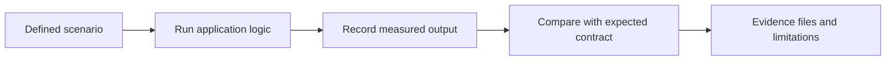

# Evaluation suite

This package runs synthetic software scenarios for the dissertation evidence. It can exercise risk and safety behaviour, but its output is not a clinical outcome study.

`scenarios.py` defines inputs; `experiments.py` holds comparison routines; `runner.py` records outputs; `__main__.py` provides the module entry point. See [evaluation evidence](../../docs/dissertation-evidence/evaluation/README.md) for preserved methodology, samples and manifests. The [testing guide](../../docs/TESTING.md) explains which checks use a disposable database or browser fixtures.

Do not treat synthetic scenarios, retrospective proxy labels or a successful API test as proof of patient benefit, prospective accuracy or safe real-world alert volume.
