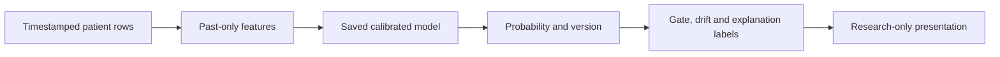

# Research model engine

This package separates temporal feature construction, retrospective metrics and runtime artifact loading. It does not replace the deterministic critical-reading path.

| Module | Purpose |
| --- | --- |
| `features.py` | Patient-grouped rolling means, variability, deltas and slopes |
| `evaluation.py` | Confusion counts, ROC-AUC, average precision, calibration and patient bootstrap metrics |
| `registry.py` | Load a versioned artifact, check evaluation/approval status and label SHAP or fallback explanations |

The installed `backend/artifacts/ml` artifact uses a **legacy forward-filled next-bin proxy**. The observed HR/BP candidate in `backend/artifacts/ml-observed-v1` failed the preset sensitivity gate and is not approved for inference. The [model card](../../docs/ML_MODEL_CARD.md) is the authoritative description of outcomes, data limits and generalisation risk.

To reproduce the dissertation curves from the installed artifact and the local prepared CSVs, activate a Python 3.12 environment with the backend dependencies and run `python scripts/build_repository_graphs.py` from the repository root. The script checks the saved confusion matrix, ROC-AUC and average precision before writing plots. Raw PhysioNet records and prepared research CSVs remain local under the ignored `backend/data/` directory.
