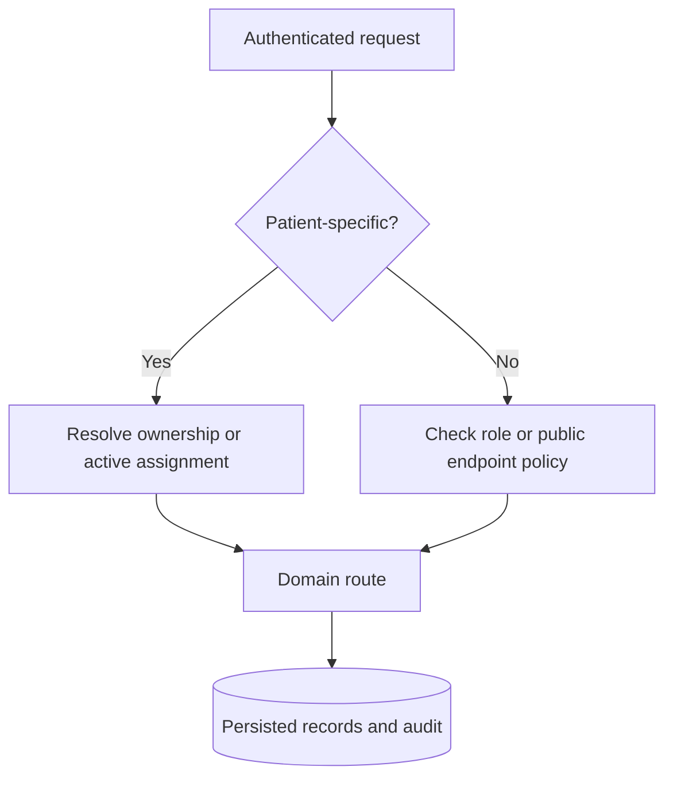

# API route map

`main.py` registers these routers. Each route remains responsible for server-side role and patient checks; the frontend's protected routes are navigation aids only. For the full request path, see [architecture](../../docs/ARCHITECTURE.md) and [role workflows](../../docs/architecture/ROLE_WORKFLOWS.md).

| Area | Router files | Main concern |
| --- | --- | --- |
| Identity and access | `auth.py`, `registration_requests.py`, `admin_users.py`, `admin_assignments.py` | Sessions, approval, roles and assignments |
| Patients and observations | `patients.py`, `vitals.py`, `wearables.py`, `integrations_withings.py`, `live_simulator.py` | Patient scope, provenance, validation and ingestion |
| Clinical work | `care_workflows.py`, `medications.py`, `reviews.py`, `referrals.py`, `events.py`, `role_actions.py` | Tasks, decisions and escalation records |
| Alerts and reporting | `notifications.py`, `analytics.py`, `audit.py` | Retained inbox state, views and traceability |
| Research and assistance | `ml.py`, `research.py`, `assistant.py` | Model governance, evidence and optional generation |

When adding a patient-scoped endpoint, reuse `get_accessible_patient` or an equivalent scoped query from `access_control.py` before retrieving related records. Avoid relying on a patient ID supplied by the browser as proof of access. For a new state-changing route, define an audit event and test both authorised and denied roles.
