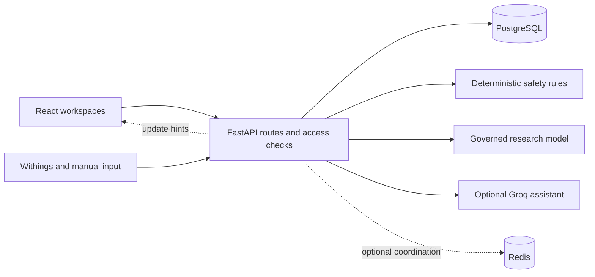

# Architecture

Vitala is a research prototype with four role-specific web workspaces. The React frontend calls a FastAPI service; PostgreSQL is the authoritative store for users, assignments, observations, alerts, care activity, and research records. WebSockets provide update hints. Redis is optional for cross-worker broadcasting and shared operational controls.

Backend patient access is checked against active staff assignments or patient ownership before records are returned. Observation ingestion validates identity, values, units, source, and timestamps before assessment. A critical measured value reaches deterministic rules independently of ML or generated text. The newer observed-window model candidate failed its sensitivity gate and is blocked from inference; the installed legacy artifact represents a different research proxy.

For the detailed contracts, see [role workflows](architecture/ROLE_WORKFLOWS.md), [measurement ingestion](architecture/MEASUREMENT_INGESTION.md), [canonical assessment](architecture/CANONICAL_RISK_ASSESSMENT.md), and [application and research separation](RESEARCH_ARCHITECTURE.md). The [request walkthrough](architecture/REQUEST_FLOW.md) traces a request end to end.
