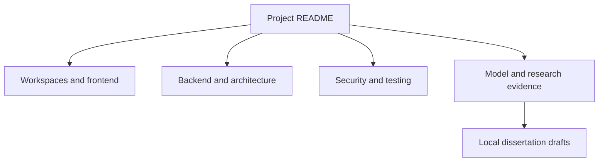

# Vitala documentation

Start with the [project README](../README.md) to run Vitala locally. This index separates software guidance from research and dissertation evidence. Live deployment is paused.

## Current technical guide

- [Architecture](ARCHITECTURE.md)
- [Security overview](SECURITY.md) and [private reporting policy](security/SECURITY.md)
- [Testing and evidence](TESTING.md)
- [ML model card](ML_MODEL_CARD.md)
- [Visual workspace and route guide](WORKSPACES.md)
- [Frontend code map](../frontend/README.md) and [backend code map](../backend/README.md)

These pages describe the current system and point to detailed contracts. The reports below retain their original dates and should be read as historical evidence.

## Dissertation and Word documents

- [Tracked dissertation](dissertation/Health_Risk_Dashboard_Dissertation.docx): dated repository copy
- [Presentation and viva guide](dissertation/Presentation_and_Viva_Guide.docx)
- [Dissertation file guide](dissertation/README.md): local submission copies and generated graph evidence

Newer submission Word drafts and generated graph packs stay local and are ignored by Git. Historical Markdown evidence remains available for review.

## Architecture and workflows

- [Shared measurement ingestion](architecture/MEASUREMENT_INGESTION.md)
- [Measurement validation contract](architecture/MEASUREMENT_VALIDATION.md)
- [Patient baseline v2](architecture/PATIENT_BASELINE.md)
- [Canonical risk assessment](architecture/CANONICAL_RISK_ASSESSMENT.md)
- [Role workflows](architecture/ROLE_WORKFLOWS.md)
- [Request and risk walkthrough](architecture/REQUEST_FLOW.md)
- [Application and research separation](RESEARCH_ARCHITECTURE.md)

## Setup and deployment

- [Deployment guide](setup/DEPLOYMENT.md)
- [Deployment checklist](setup/DEPLOYMENT_CHECKLIST.md)
- [Groq AI setup](setup/AI_SETUP.md)
- [Withings integration setup](setup/WITHINGS_SETUP.md)
- [Database migrations](../backend/MIGRATIONS.md)
- [Script map](../scripts/README.md)

## Security and testing

- [Security policy and reporting](security/SECURITY.md)
- [Isolated PostgreSQL verification](testing/LOCAL_POSTGRESQL.md)
- [Phase 6 infrastructure and CI verification](testing/PHASE_6_INFRASTRUCTURE_REPORT.md)
- [Phase 7 integration-hardening report](testing/PHASE_7_INTEGRATION_HARDENING_REPORT.md)
- [Product test and deployment-readiness report](testing/PRODUCT_TEST_REPORT.md)
- [Formal test matrix](FORMAL_TEST_MATRIX.md)
- [Complete automated test inventory](testing/COMPLETE_TEST_INVENTORY.md)
- [9 November local verification snapshot](reports/LOCAL_VERIFICATION_2026-11-09.md)
- [Engineering audit](reports/ENGINEERING_AUDIT_2026-11-09.md)
- [Dated audit and progress reports](reports/README.md)
- [Accessibility test plan](ACCESSIBILITY_TEST_PLAN.md)
- [Usability evaluation protocol](USABILITY_EVALUATION.md)

## AI, ML, and research evidence

- [Model card and dataset contract](ML_MODEL_CARD.md)
- [Observed-target model validation and limits](reports/ML_PIPELINE_VALIDATION_REPORT.md)
- [Validation and generalisation plan](VALIDATION_AND_GENERALISATION.md)
- [Regulatory preparation boundary](REGULATORY_PREPARATION.md)
- [Dissertation implementation evidence](DISSERTATION_EVIDENCE.md)
- [Reproducible dissertation evaluation suite](dissertation-evidence/README.md)
- [Generated evidence pack](evidence/README.md)
- [Dissertation source, figures, screenshots, and audits](dissertation/)

## Development history

- [Implementation status snapshot](development/IMPLEMENTATION_STATUS.md)
- [Development issues and fixes](development/DEVELOPMENT_ISSUES_AND_FIXES.md)

The dated status and test reports are project history. For current claims, use the code, latest automated checks, model card, and [claims-versus-code audit](dissertation/CLAIMS_VS_CODE_AUDIT.md).
