# Vitala workspaces

This is a visual map of the screens a user sees and the records each area uses. Route access in the browser improves navigation; **the FastAPI service enforces patient and role access**. Screenshots in the dissertation are dated research captures. The diagrams below describe the current route structure without presenting synthetic demonstration values as clinical results.

## Doctor: clinical review

The doctor workspace starts with assigned patients and moves toward evidence and a recorded action. The main screen is `/doctor`; `/analytics`, `/review-cases`, `/reports` and `/referrals` support deeper review.

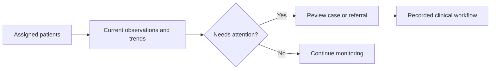

## Nurse: care workflow

The nurse's `/nurse` and `/care` screens organise observation, medication and task activity around the selected assigned patient. Review cases and notifications expose escalation state.

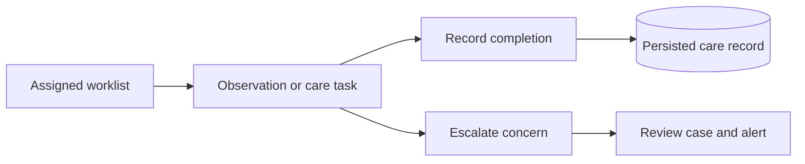

## Patient: personal overview

`/patient` explains the patient's own measurements. `/devices` shows connection and synchronisation state; `/care` and `/account` expose relevant care and security tasks. Missing data and source labels remain visible.

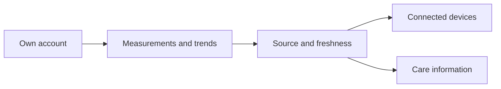

## Administrator: operations

`/admin` links to `/admin/users`, `/admin/approvals`, `/admin/assignments`, `/admin/operations`, `/admin/research` and `/audit-logs`. Administrative access does not imply routine access to patient charts.

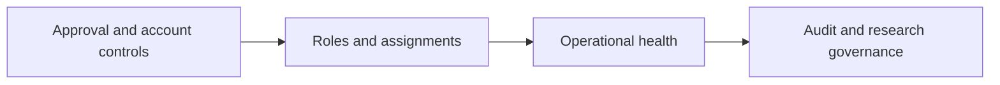

## Model intelligence

`/analytics` gives doctors retrospective model evidence; `/admin/research` contains restricted research and governance records. The installed forward-filled proxy model is distinct from the newer observed HR/BP candidate, which failed its inference gate.

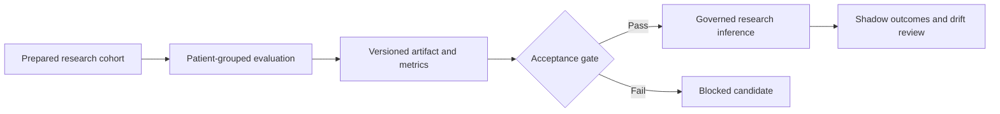

The [model card](ML_MODEL_CARD.md) defines the two outcomes and their limitations. The [reproducible graph script](../scripts/build_repository_graphs.py) scores the installed artifact without retraining it.

## AI assistant

`/ai-assistant` offers patient-scoped summaries with timestamps, references, missing-data disclosures and generation status. An external provider is optional; its output is checked but still requires human review.

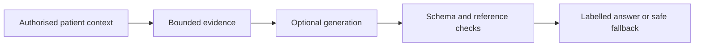

## Devices and observations

`/devices` shows linked devices and sync outcomes. Manual, simulated, uploaded and provider-originated measurements keep distinct provenance. A webhook is a retrieval hint; the backend fetches provider measurements before ingestion.

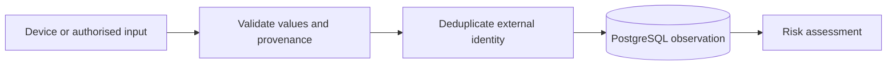

## Alerts and notifications

`/notifications` displays retained inbox state for all roles; `/review-cases` provides clinician review. PostgreSQL is authoritative. WebSockets and optional Redis make changes visible sooner, while reconnect and polling recover the view.

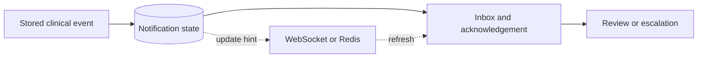

## Supporting pages

| Task | Frontend route | Starting point |
| --- | --- | --- |
| Sign in, access request, password reset | `/login`, `/register`, `/reset-password` | [Frontend guide](../frontend/README.md) |
| Upload observations | `/upload` | [Ingestion contract](architecture/MEASUREMENT_INGESTION.md) |
| Reports and referrals | `/reports`, `/referrals` | [Role workflows](architecture/ROLE_WORKFLOWS.md) |
| Account security | `/account` | [Security overview](SECURITY.md) |
| Testing and accessibility | Browser and API checks | [Testing guide](TESTING.md) |

## Verified visual captures

These 360-pixel Chromium captures used synthetic fixtures on 10 November 2026. They show layout behaviour, not live provider delivery or a physical-phone test.

| Sign-in validation | Patient overview | Clinical alerts |
| --- | --- | --- |
| 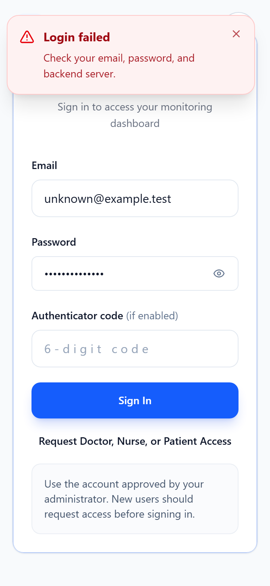 | 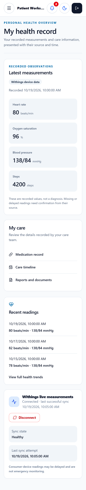 | 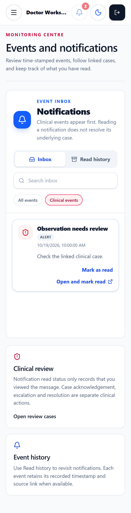 |
