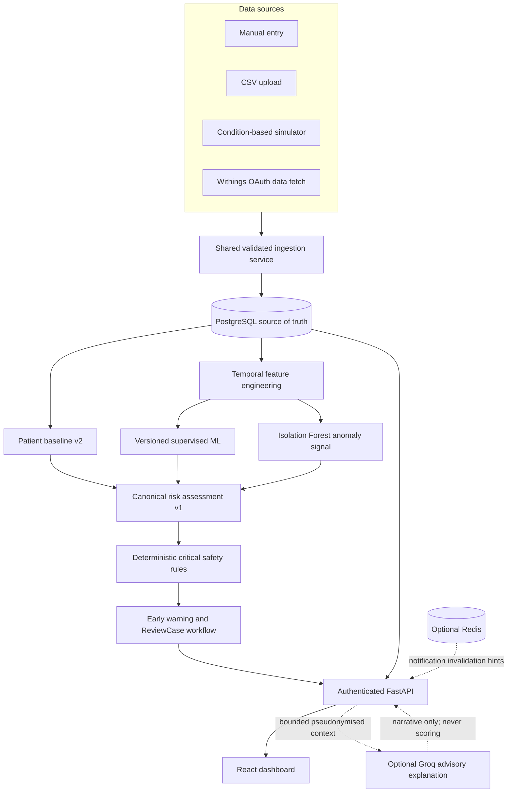

# Final implemented architecture

## Interpretation

All accepted observations pass through the shared validation, UTC normalization,
deduplication, persistence, and post-ingestion hooks before they are available to
downstream assessment. PostgreSQL is authoritative. Patient-relative baselines,
temporal ML features, and anomaly evidence inform the versioned canonical
assessment, while deterministic critical thresholds retain escalation priority.

Groq is a separate, optional advisory branch. It receives bounded server-built
context only after authorization and cannot change risk scores, predictions,
alerts, or ReviewCases. Redis carries non-authoritative change hints; REST
polling and PostgreSQL state remain available when Redis fails.

## Deployment mapping

The intended portfolio deployment maps the React build to Vercel, FastAPI to
Render, PostgreSQL to Neon, and optional Redis to Upstash. Groq remains disabled
unless its configuration and governance gates are satisfied. This diagram
describes implemented component relationships, not proof that each external
provider is currently healthy.
