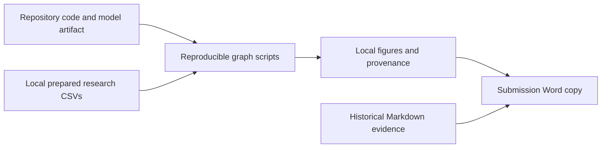

# Dissertation materials

This directory separates the published project record from local submission drafts. The tracked `Health_Risk_Dashboard_Dissertation.docx` is a dated academic document. Later edited Word copies and the graph export pack are kept locally by `.gitignore`; they are not automatically part of a GitHub push.

## Where to look

| Material | Location | Status |
| --- | --- | --- |
| Tracked dissertation | `Health_Risk_Dashboard_Dissertation.docx` | Historical repository copy |
| Latest locally revised dissertation | `Vitala_Dissertation_Final_Figures.docx` when present | Local submission candidate; not pushed by default |
| Presentation and viva guide | `Presentation_and_Viva_Guide.docx` | Tracked companion document |
| Current plot outputs | `graphs-reproduced/` when generated | Local SVG, PNG, CSV and manifest files |
| Dated claims, references and layout audits | `CLAIMS_VS_CODE_AUDIT.md`, `REFERENCE_AUDIT.md`, `FINAL_DISSERTATION_AUDIT.md` | Historical reviews, read with their dates |
| Older Markdown build source | `dissertation_source.md` | Historical source; do not regenerate the newer Word draft from it |

Generate research plots with `python scripts/build_repository_graphs.py` after installing the backend development dependencies and restoring the prepared local dataset. `python scripts/build_dataset_excerpt.py` creates a labelled image of actual prepared CSV rows. The plot script checks that model scores reproduce saved confusion counts, ROC-AUC and average precision before exporting curves. See the [model card](../ML_MODEL_CARD.md) for the outcome limitation.

The final local Word copy includes the prepared CSV excerpt, removes older explanatory diagrams and retains verified evaluation graphs. Raw PhysioNet observation timestamps were not available locally for an observed vital-sign trace, so no such line graph was invented. A Word file should be rendered and its contents page checked again after any future edits.
