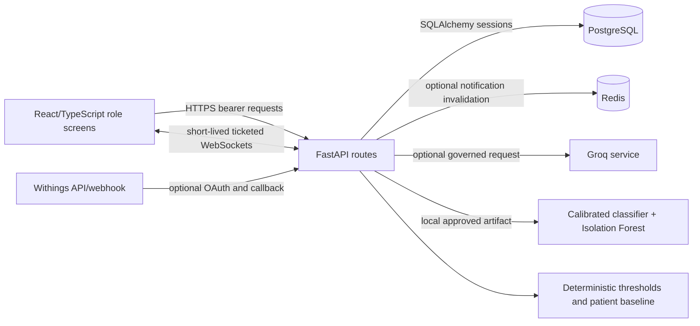

# Supervisor meeting preparation — 19 October 2026

**Project:** Design and Implementation of an AI-Assisted Healthcare Health Risk Monitoring Dashboard
**Meeting:** Dr Md Hasan, Anglia Ruskin University
**Purpose:** An evidence-led briefing and first-person practice script. Repository paths below are relative to the project root. The spoken answers are prompts for rehearsal, not claims that a clinical study took place.

## Executive project summary

I built a full-stack research prototype for monitoring health observations and organising patient care work. React and TypeScript provide role-specific screens; FastAPI enforces identity, role and patient access; PostgreSQL stores records and audit evidence. A separate, versioned scikit-learn model estimates whether a **threshold-defined critical vital event** will appear in the next six-hour bin. Deterministic critical thresholds remain independent of the model. Optional Groq assistance produces bounded, evidence-linked text. WebSockets carry update hints and Redis can fan out notifications. This is a software and retrospective ML proof of concept, with no demonstrated clinical effectiveness or regulatory approval.

The strongest contribution is the explicit combination of access boundaries, reproducible proxy-outcome evaluation, deterministic escalation, model governance and honest reporting of limits. The strongest challenge is the gap between the ICU training data and the proposed outpatient/wearable use. There is also a **specific target-validity concern**: preparation forward-fills vital values before assigning next-window labels, and the prepared Set A and Set B CSVs have **100% missing SpO₂**. Consequently the dissertation's phrase *“genuinely observed critical vital event in the following six-hour window”* overstates what the code establishes. The target is a **forward-filled, threshold-derived six-hour proxy**, primarily from available heart rate and blood pressure in these files. The original PhysioNet Challenge target was in-hospital mortality; this project constructs its own outcome from the time series. [PhysioNet's dataset description](https://physionet.org/content/challenge-2012/1.0.0/) lists **SaO₂**, not the **SpO₂** field sought by the preparation script.

## Audit scope and evidence rules

This briefing checks the **working tree on 19 October 2026**, including uncommitted code changes from the immediately preceding repair session. I read source, tests, the dissertation Markdown and DOCX, committed evidence, the local prepared CSVs, and the model report. The only filesystem write in this audit is this Markdown file. The model check read the trusted, repository-provided joblib artifact and recomputed internal and Set B predictions; it neither trained a model nor changed patient data. I did not call Groq, Withings, Redis or the hosted deployment. Statements labelled “previous session” refer to verification already performed in this conversation, rather than a fresh test run for this report. Historical reports retain their own dates.

Evidence status used below: **Verified** = directly supported by current code or a read-only reproduction; **Partially verified** = implemented with an important boundary; **Historical evidence** = documented earlier but not repeated now; **Unverified** = evidence insufficient; **Not implemented** = absent as a completed capability or study. Code paths prove design and reachable logic, not clinical efficacy or live provider availability.

## Architecture and how the parts communicate

| Layer | What is implemented, with primary code |
|---|---|
| Frontend | `frontend/src/app/routes.tsx` declares lazy role-protected routes; `context/AuthContext.tsx` holds the browser session; `context/HealthDataContext.tsx` loads accessible patients and vitals; `services/api.ts` centralises bearer requests and refresh; `services/socketAuth.ts` obtains ticketed socket URLs; `pages/Dashboard.tsx`, `CareWorkspace.tsx`, `ResearchWorkspace.tsx` and role pages present the workflows. Vite/React/TypeScript, Tailwind, Recharts and Radix are in `frontend/package.json`. |
| API | `backend/main.py` assembles FastAPI routers, middleware, health endpoints and a live-vital socket. `backend/config.py` validates environment settings; `backend/database.py` configures a PostgreSQL-only SQLAlchemy engine. |
| Persistence | `backend/models.py` defines users, patients, staff assignments, vitals, medication, cases, notifications/read receipts, auth sessions, AI memory, governance and research records. Alembic versions under `backend/alembic/versions/` reach `20260914_0018`. |
| Identity/privacy | `backend/routes/auth.py` handles login, token refresh, logout, MFA and password reset. `backend/auth_utils.py` hashes passwords with Argon2id, issues JWTs and resolves active users. `backend/access_control.py` scopes patient queries; admin is excluded from clinical records. `routes/registration_requests.py`, `admin_assignments.py` and `referrals.py` govern access. |
| Observations and care | `backend/routes/vitals.py`, `measurement_ingestion.py`, `early_warning.py`, `baseline_service.py`, `risk_assessment.py`, `routes/role_actions.py` and `routes/care_workflows.py` validate observations, persist them, assess risk and support cases, notes, medications and care tasks. `routes/integrations_withings.py` contains optional OAuth and provider retrieval. |
| ML and explanation | `backend/scripts/prepare_physionet_2012.py` prepares eight six-hour bins per ICU record; `scripts/train_ml_models.py` compares candidates, calibrates the selected classifier, chooses a threshold and fits Isolation Forest. `backend/ml_engine/features.py`, `evaluation.py` and `registry.py` implement features, metrics and runtime loading. `backend/artifacts/ml/evaluation.json` and `model.joblib` are the installed artifact. SHAP is attempted with a coefficient fallback. |
| AI/live features | `backend/routes/assistant.py` builds bounded context, calls Groq only when enabled, validates returned schema/evidence and supplies deterministic fallback. `routes/notifications.py` and `notification_broadcast.py` combine persisted notifications, WebSockets and optional Redis. `live_updates.py` is process-local vital fan-out. |
| Verification/operations | `backend/tests/`, `frontend/tests/e2e/`, `.github/workflows/ci.yml`, `frontend/vercel.json`, `render.yaml`, `docs/setup/DEPLOYMENT.md` and `scripts/production_smoke.py` cover tests and deployment configuration. Infrastructure declarations do not prove the hosted system is presently healthy. |

Typical observation flow: a clinician with an accessible patient posts a validated vital through `routes/vitals.py`; `measurement_ingestion.ingest_vital` deduplicates, audits and commits it; `early_warning.evaluate_new_vital` applies critical rules first and may store a governed shadow prediction; the dashboard reloads persisted records after live hints. Typical patient read flow: `apiFetch` attaches the JWT; `get_current_user` checks the account; `get_accessible_patient` or a patient-scoped query restricts each route; PostgreSQL returns only records in scope. An admin can manage an assignment in the admin directory without becoming a clinician for that patient's records.

## Current implementation status and claim check

| Significant claim | Status | Evidence and boundary |
|---|---|---|
| Four role-specific experiences and server-side patient access | **Verified** | `frontend/src/app/routes.tsx`; `backend/access_control.py`; `routes/role_actions.py`; relevant `backend/tests/test_security.py`. UI hiding is only a convenience; backend queries enforce scope. |
| Argon2id, access/refresh tokens, MFA and audit | **Partially verified** | `backend/auth_utils.py`, `routes/auth.py`, `routes/care_workflows.py`, `models.py`. Code and tests exist; no independent penetration test or production identity audit was found. |
| PostgreSQL migrations and operational schema | **Verified** | `backend/alembic/versions/` to `20260914_0018`, `database.py`, `.github/workflows/ci.yml`. The prior session upgraded a disposable local review database and ran PostgreSQL tests. |
| Live observations and durable notifications | **Partially verified** | `main.py`, `live_updates.py`, `routes/notifications.py`, `notification_broadcast.py`. PostgreSQL is durable; vital fan-out is process-local, Redis is optional, and socket hints are not guaranteed delivery. |
| Withings connection and webhook | **Partially verified** | `routes/integrations_withings.py`, `docs/dissertation-evidence/LIMITATIONS.md`. OAuth/token/webhook code exists. A Withings measurement group lacking any of eight wide-schema fields is skipped; provider connectivity and end-to-end device ingestion were not demonstrated here. The webhook uses a registered secret query token; it is not cryptographic body-signature verification. |
| Model predicts an independently observed future clinical event | **Unverified as phrased** | `scripts/prepare_physionet_2012.py` constructs a threshold proxy **after** forward fill. No adjudicated clinical outcome is used. |
| A SpO₂ threshold contributes to reported Set A/B performance | **Not implemented in those prepared files** | `PARAMETER_MAP` seeks `SpO2`; local `train.csv` and `external.csv` contain 28,000/28,000 missing `spo2` values each. PhysioNet describes `SaO2`. The runtime rule can still use application SpO₂. |
| Patient-separated model evaluation | **Verified** | `scripts/train_ml_models.split`, `ml_engine/features.py`; read-only reproduction found 2,560/640/800 distinct training/validation/test patients with zero overlaps. |
| Internal metrics and related Set B metrics | **Verified for the installed artifact** | `backend/artifacts/ml/evaluation.json`; recomputed predictions matched its confusion matrices and summary metrics. This supports reproducibility of the proxy task, not clinical validity. |
| Logistic regression chosen for best validation discrimination | **Verified** | `scripts/train_ml_models.py` selects by validation ROC-AUC, F1 tie-break. Logistic ROC-AUC 0.810 versus random forest 0.791. Random forest has better validation PR-AUC; selection is not a claim of universal superiority. |
| Sigmoid calibration and 0.014 operating threshold | **Verified** | `train_ml_models.py` fits `CalibratedClassifierCV` on validation data, then seeks sensitivity ≥0.70 while maximising sensitivity + specificity −1. The threshold is **1.4% probability**, conditional on the learned proxy and training distribution. |
| SHAP explanations are always produced | **Partially verified** | `ml_engine/registry.py` attempts SHAP and falls back to coefficients on errors. `docs/dissertation-evidence/evaluation/shap_attribution_summary.json` recorded the fallback in 10/10 controlled evaluations. `docs/evidence/global-shap.json` is a historical generated sample; it does not prove every live request used SHAP. |
| AI summaries cannot hallucinate | **Unverified** | `routes/assistant.py` enforces JSON schema, allowed source IDs and timestamp matching, and can reject output; these checks cannot establish semantic medical truth. Groq is optional and disabled by default in `config.py`/`render.yaml`. |
| Clinical monitoring is safe and effective | **Not implemented as a validated claim** | No prospective clinical effectiveness or regulatory evidence in repository; `docs/dissertation-evidence/LIMITATIONS.md` explicitly excludes it. |
| Research workspace proves completed usability/prospective studies | **Not implemented as completed studies** | `routes/research.py` stores consent, SUS responses, adjudications and effectiveness records; no verified recruited study or prospective clinical cohort result is supplied. |
| Production deployment currently works | **Unverified; latest retained smoke failed** | `docs/dissertation-evidence/deployment/production-smoke-2026-09-14.json`: frontend 200, backend liveness/readiness 503 (`service_suspended`), seven authenticated checks skipped. `render.yaml` and `frontend/vercel.json` show intended configuration, not October uptime. |
| Accessibility established | **Partially verified** | `frontend/tests/e2e/accessibility.spec.ts` supplies Axe and keyboard checks. The previous session got a passing local browser run. There is no documented assistive-technology participant study. |
| Security fully demonstrated | **Partially verified** | Role tests, middleware, session checks and audit exist; no independent penetration test or assurance for real patient data. |

**Dissertation disagreements to disclose:** The current `docs/dissertation/dissertation_source.md` and its DOCX abstract/chapter text still describe the target as a *“genuinely observed”* critical event, while the preparation script labels the next **forward-filled** bin and the prepared data have no SpO₂. The dissertation reports **50 backend tests** and **3 passed, 12 failed, 1 skipped** browser tests from its August audit. Those numbers are historical; the previous session in this conversation recorded **111 existing backend tests passing**, **four new targeted regression tests passing**, **19 default browser tests passing with one opt-in test skipped**, and the separate opt-in admin login test passing against an isolated database. These are separate runs, not a single 115-test suite or a production result. `docs/testing/PHASE_8_DEPLOYMENT_EVIDENCE_REPORT.md` has another dated result (111 backend, 18 browser passing, one skipped) from September. A 19 October submission should update dates and counts only after archiving the exact run and commit.

## Machine-learning method and interpretation

`prepare_physionet_2012.prepare_set` downloads ICU text records, maps HR and invasive/non-invasive blood pressure fields, divides elapsed time into eight six-hour bins for the first 48 hours, keeps the last measurement per bin, reindexes all bins, then forward-fills. For bin *t*, the target is one if the **next** bin's filled value crosses SpO₂ <90%, HR <40 or >140, systolic BP ≥180 or diastolic BP ≥120. The final bin is excluded because it has no next bin. Steps, sleep, activity and calories are set missing rather than invented. Set A creates 28,000 rows from 4,000 patients, with 370 positive proxy labels. Set B produces another 28,000 rows/4,000 patients, 515 positives. The Set A SHA-256 matches the installed report (`65227781…27e3014bda92`).

**Forward-fill validity:** If a critical measurement was taken in bin *t* and no fresh measurement was taken in *t+1*, the filled value can label *t* as positive despite no new observed critical event in *t+1*. The method also hides how old an observation is. Therefore the defensible phrase is “next-bin threshold proxy after last-observation carry-forward”; repeat labelling and timing uncertainty should be quantified. The script does not map PhysioNet's SaO₂ field to `spo2`, so oxygen-saturation proxy labels cannot be generated from these prepared files. Treating SaO₂ and wearable SpO₂ as interchangeable would itself require clinical and measurement justification. Source: `backend/scripts/prepare_physionet_2012.py`; [PhysioNet Challenge 2012](https://physionet.org/content/challenge-2012/1.0.0/).

`ml_engine/features.engineer_features` sorts by patient and time, computes eight raw features and four longitudinal summaries per feature (rolling mean and standard deviation, delta, five-point slope). `train_ml_models.split` partitions patients, preventing same-patient rows entering training and test. Candidate logistic regression and random forest use median imputation inside their pipelines. Selection uses **validation ROC-AUC**, with F1 only as a tie-breaker; sigmoid calibration then fits on the validation subset. Threshold selection uses that same validation subset, so the independent test is essential. Isolation Forest fits separately to negative training rows and supplies an anomaly signal; it is not the supervised six-hour predictor. `ml_engine/registry.explain` attempts local SHAP and catches errors with a coefficient-based attribution fallback. Neither method proves causation.

| Recomputed read-only metric | Internal Set A test (5,600 rows; 76 positive) | Related Set B (28,000 rows; 515 positive) |
|---|---:|---:|
| ROC-AUC (ranking across thresholds) | 0.83325 | 0.78539 |
| PR-AUC (precision–recall across thresholds) | 0.16552 | 0.10647 |
| Sensitivity/recall (TP ÷ all actual positive) | 0.72368 | 0.72427 |
| Specificity (TN ÷ all actual negative) | 0.74602 | 0.72527 |
| Precision (TP ÷ all predicted positive) | 0.03772 | 0.04707 |
| Brier score (mean squared probability error) | 0.01242 | 0.01732 |
| Confusion matrix at 0.014 | TP 55, FP 1,403, FN 21, TN 4,121 | TP 373, FP 7,551, FN 142, TN 19,934 |

An internal precision of 3.77% means roughly **96 of 100 positive model flags are false positives against this proxy**. The low 1.36% test prevalence and sensitivity-oriented threshold help explain that burden. A low Brier score can coexist with poor precision under rare outcomes; neither number alone proves a useful alert policy. Set B is external to model fitting but belongs to the **same ICU challenge family**, so it does not show outpatient or smartwatch transportability. The local artifact was serialised with scikit-learn **1.8.0** and reproduced under **1.9.1** with version-mismatch warnings. That is a reproducibility and deployment risk; pinning and rebuilding in a documented environment should precede strong operational claims. The artifact was read from a trusted repository path; untrusted joblib files must not be loaded.

## Testing, deployment and evidence maturity

| Evidence | What it supports | Boundary |
|---|---|---|
| Prior-session local checks, 19 October | Frontend build/lint passed; 111 existing backend tests passed on isolated PostgreSQL, four new targeted tests passed; 19 default Playwright cases passed, one opt-in login case passed separately. | Runs occurred before this analysis request and include local uncommitted fixes; retain commands/output and repeat at a known commit for submission. Browser mocks do not exercise the hosted stack. |
| Read-only reproduction in this audit | Prepared-data counts/missingness/hash, patient-disjoint split, installed classifier internal and Set B metrics. | No training rerun; metrics match the committed artifact under a different sklearn version. |
| `docs/dissertation-evidence/evaluation/summary.json` dated 11 September | Eight fixed synthetic scenarios, critical override 3/3, shadow-mode behaviour, Groq independence, mean 22.0 ms and p95 85.5 ms over 30 local runs. | Synthetic scenarios, SQLite in-memory and one workstation. `false_alert_summary.json` shows 0/30 **normal sequences with ML disabled**, not a clinical false-alert rate. Its attribution evaluation used coefficient fallback. |
| `docs/dissertation-evidence/deployment/local-production-preflight.json` dated 14 September | Disposable PostgreSQL 16 migration upgrade/downgrade/re-upgrade and configuration preflight passed. | No external deployment proof. |
| `docs/dissertation-evidence/deployment/production-smoke-2026-09-14.json` | Vercel frontend returned 200; Render backend liveness/readiness returned 503; login and patient chain skipped. | No current October production status verified. The present local `127.0.0.1` API is a separate environment. |
| `.github/workflows/ci.yml` and `frontend/tests/e2e/` | Automated backend, lint, build, browser, dependency-audit and secret-scan gates are defined. | Workflow presence is not a green run for the current working tree. Accessibility automation does not replace assistive-technology evaluation. |

The September product report's **0 vulnerabilities** is historical. The preceding local `npm ci` in this conversation reported **three vulnerabilities (one low, two high)** with newer dependency resolution. Do not repeat “0 vulnerabilities” as a current security result without a fresh audit at the final lockfile and date. No dependency installation or audit fix was performed for this briefing.

## Forty realistic supervisor questions and practice answers

Each **Say** paragraph is in my first person and is intended for roughly 30–60 seconds of spoken delivery. **Depth** is a technical expansion if Dr Hasan probes further; **Evidence** points to repository paths; **Follow-up** and **Challenge** are prompts to rehearse, not claims of completed work.

### 1. Project background and motivation

**1. What problem did you set out to solve? — High**
**Say:** “I wanted to investigate whether repeated observations could be presented in a way that helps a clinician review change over time while preserving patient privacy. A single dashboard can combine trends, current measurements and care actions, but the difficult part is deciding which signals deserve attention and who is allowed to see them. I therefore built a research prototype that joins role-based access, deterministic safety checks and a clearly labelled predictive signal. Its aim is to support review, not make a diagnosis.”
**Depth:** Separate information retrieval, alert policy and clinical outcomes; the code only tests the first two. **Evidence:** `README.md`, `backend/risk_assessment.py`, `frontend/src/app/pages/Dashboard.tsx`. **Follow-up:** Which user task benefits most? **Challenge:** No measured improvement in clinician decisions.

**2. Why use an AI-assisted dashboard rather than simple charts? — High**
**Say:** “Charts alone show data, but they leave the user to inspect every observation. My prototype adds structured checks: absolute critical thresholds, a patient-specific baseline, a six-hour proxy prediction, and optional summaries. The order matters: a critical physiological reading must remain visible even if a model is unavailable or disagrees. I regard the AI as a research aid for prioritisation and explanation. The evidence does not show that these additions improve clinical outcomes, so the user remains responsible for interpretation.”
**Depth:** Canonical assessment is read-only and separates deterministic, baseline, ML and alert evidence. **Evidence:** `backend/risk_assessment.py`, `backend/early_warning.py`, `frontend/src/app/components/MLPredictionPanel.tsx`. **Follow-up:** Would a simpler rules-only system be safer? **Challenge:** Added complexity may outweigh benefit.

**3. Who is the system for? — High**
**Say:** “I designed distinct workflows for doctors, nurses, patients and administrators. Clinicians review assigned patients and record or act on observations; patients can inspect the record linked to their account; administrators approve access and manage staff assignments and operations. The backend restricts each action by role and patient relationship. These are proposed user roles for a prototype, not evidence that a real clinical organisation has accepted the workflow. Human-factors research would be needed before adopting it in practice.”
**Depth:** `patient_query_for_user` filters doctors, nurses and patients differently; admin clinical queries return an empty scope. **Evidence:** `backend/access_control.py`, `backend/routes/role_actions.py`, `frontend/src/app/routes.tsx`. **Follow-up:** Who handles an unassigned patient? **Challenge:** No observed clinical workflow study.

**4. What distinguishes this project from a standard CRUD dashboard? — Medium**
**Say:** “The interesting part is the integration of boundaries and evidence around the data. An observation passes validation, persistence, patient-relative comparison and independent critical rules. The research model has an explicit outcome, version, threshold and evaluation report, while the assistant receives bounded context and must cite known record IDs. I also added shadow mode, drift information and a research evidence area. Those mechanisms are implemented software features; their clinical value still has to be demonstrated with representative data and users.”
**Depth:** Novelty is engineering integration and critical evaluation, not a new ML algorithm. **Evidence:** `backend/measurement_ingestion.py`, `backend/early_warning.py`, `backend/routes/assistant.py`, `backend/routes/research.py`. **Follow-up:** What is the original academic contribution? **Challenge:** Most component methods are established.

### 2. Research aims, objectives and contribution

**5. State your research aim in one sentence. — High**
**Say:** “My aim is to design, implement and critically evaluate an AI-assisted monitoring prototype that presents longitudinal health observations with enforceable privacy boundaries and transparent risk evidence. I define success at the level I can test: correct access decisions, reproducible model evaluation on a specified proxy outcome, and understandable failure behaviour. I do not define success as improved patient outcomes, because I have not conducted a prospective clinical study. This distinction keeps the dissertation's engineering contribution separate from future clinical validation.”
**Depth:** Chapter 1 gives the research questions and scope; repository tests exercise software behaviour. **Evidence:** `docs/dissertation/dissertation_source.md`, `docs/dissertation-evidence/LIMITATIONS.md`. **Follow-up:** Which objective is best evidenced? **Challenge:** Objectives may be broader than measured results.

**6. What exactly is your contribution? — High**
**Say:** “I implemented a full-stack reference prototype and an audit trail from data ingestion through risk presentation. I contributed the design choice to keep deterministic critical rules independent of the learned model, patient-scoped access for each clinical route, and an explicit retrospective model card with operating characteristics. I also documented cases where the result is weak, especially precision and population mismatch. I would not claim to have invented logistic regression, SHAP or early warning scores. The contribution is the tested integration and its critical assessment.”
**Depth:** Distinguish artefact, experimental evidence and scientific generalisation. **Evidence:** `backend/access_control.py`, `backend/risk_assessment.py`, `docs/ML_MODEL_CARD.md`, `backend/artifacts/ml/evaluation.json`. **Follow-up:** What would a published research claim be? **Challenge:** Integration alone may need stronger user evaluation.

**7. How do the research questions map to evidence? — Medium**
**Say:** “The architecture question maps to role routes, patient-scoped queries and workflow tests. The safe-AI question maps to deterministic overrides, schema and citation checks, and shadow operation. The engineering-evaluation question maps to backend tests, browser tests, model metrics and synthetic scenario reports. The final question is a critical appraisal: I can say the prototype implements and tests many requirements, but I cannot say it is clinically validated. That gap is an answer to the research question, not something to hide.”
**Depth:** Chapter 7 discusses the four questions; synthetic scenarios measure software properties only. **Evidence:** `docs/dissertation/dissertation_source.md`, `docs/dissertation-evidence/evaluation/summary.json`, `backend/tests/test_security.py`. **Follow-up:** Which question lacks evidence? **Challenge:** Human usability and production operation are weakly evidenced.

**8. What would count as a successful final-year outcome? — Medium**
**Say:** “For a BEng project, I would regard a functioning, reproducible prototype and an honest evaluation as defensible. I can demonstrate role and patient boundaries, validated observation storage, a traceable model artifact, local tests and documented limitations. I should also show exactly where the model's apparent discrimination fails to translate into usable precision. A stronger outcome would include a prespecified usability study and an independent outpatient cohort, but I should report those as future work unless they are actually completed.”
**Depth:** Evidence maturity is more useful than one blanket ‘complete’ label. **Evidence:** `docs/dissertation/CLAIMS_VS_CODE_AUDIT.md`, `docs/VALIDATION_AND_GENERALISATION.md`, `.github/workflows/ci.yml`. **Follow-up:** Which deliverables are essential before submission? **Challenge:** The dissertation still contains stale test counts.

### 3. System architecture and technology choices

**9. Why React, TypeScript and FastAPI? — High**
**Say:** “React lets me build separate but reusable screens for the four roles, and TypeScript makes API shapes and component props explicit. FastAPI provides request validation, dependency-based authentication and a clear route structure in Python, which also hosts the ML runtime. This separation lets the browser present information while the server owns access decisions. It also creates deployment and API-contract work: a type declaration in the frontend cannot guarantee the backend response, so I need tests and disciplined versioning.”
**Depth:** Vite code splitting reduces initial route load; Pydantic validates backend inputs. **Evidence:** `frontend/package.json`, `frontend/src/app/routes.tsx`, `backend/main.py`, `backend/schemas.py`. **Follow-up:** Why not one Python-rendered app? **Challenge:** More components raise operational complexity.

**10. Trace a measurement from interface to screen. — High**
**Say:** “A doctor or nurse selects a patient and submits an observation through the shared frontend API service. FastAPI authenticates the bearer token, checks the clinician's role and that this patient is assigned to them, then validates the vital fields. The ingestion service deduplicates and persists the record with an audit entry. Early warning can create a case or store a governed model signal. The screen reloads the database-backed vital history; a WebSocket is an update hint and does not replace PostgreSQL as the source of truth.”
**Depth:** Measurement processing may occur after the initial commit; inspect that boundary when discussing atomicity. **Evidence:** `frontend/src/app/services/api.ts`, `backend/routes/vitals.py`, `backend/measurement_ingestion.py`, `backend/early_warning.py`. **Follow-up:** What happens if warning evaluation fails? **Challenge:** Persistence and downstream alerting are not one transaction.

**11. Why use WebSockets and Redis? — Medium**
**Say:** “A WebSocket can tell the browser promptly that an observation or notification has changed. I keep the durable record in PostgreSQL and use REST to retrieve authoritative data. The vital WebSocket has a short-lived, route-scoped ticket; notification updates can use Redis to fan out invalidations across instances, with polling when Redis is absent. This design is suitable for a prototype but does not promise exactly-once delivery. Vital fan-out is local to one process, which is particularly relevant if the API is later scaled to several workers.”
**Depth:** The current one-worker deployment avoids cross-worker vital fan-out, but it is still a scaling limit. **Evidence:** `backend/main.py`, `backend/live_updates.py`, `backend/notification_broadcast.py`, `frontend/src/app/services/socketAuth.ts`. **Follow-up:** How would you avoid missed updates? **Challenge:** Socket reconnect does not equal event replay.

**12. What does the frontend trust the backend to decide? — High**
**Say:** “The frontend may hide routes or controls based on the user role to make the interface usable, but it cannot enforce privacy on its own. The API checks the token and account state and applies patient-scoped database queries. An administrator can see a limited assignment directory but not the general clinical record. This matters because a user can call an HTTP endpoint directly or alter their browser. My security claim is the backend boundary and its tests, with the caveat that these tests are not a penetration assessment.”
**Depth:** Inaccessible patients intentionally yield 404. **Evidence:** `frontend/src/app/components/ProtectedRoute.tsx`, `backend/access_control.py`, `backend/routes/admin_assignments.py`, `backend/tests/test_security.py`. **Follow-up:** Why return 404? **Challenge:** Check every route for consistent helper use.

### 4. Database design

**13. Why PostgreSQL and Alembic? — High**
**Say:** “The project has related records: users, patients, assignments, observations, cases, notifications and research evidence. PostgreSQL supports relational constraints and transactions for those links. Alembic makes schema change explicit so local and deployed environments can move through the same revision history, rather than having application startup silently invent tables. I use SQLAlchemy for model mapping and query scoping. The repository reaches migration `20260914_0018`, and disposable upgrade and downgrade rehearsals are documented. That does not mean every production migration has been tested under live load.”
**Depth:** PostgreSQL-only configuration avoids a silent SQLite production fallback. **Evidence:** `backend/models.py`, `backend/database.py`, `backend/alembic/versions/`, `docs/dissertation-evidence/deployment/local-production-preflight.json`. **Follow-up:** How would you roll back data changes? **Challenge:** A schema rollback may not restore data.

**14. How are a patient and their clinicians linked? — High**
**Say:** “The patient record can link to a patient user account, and a separate patient–staff assignment table records doctor or nurse relationships and their active status. Admin approval creates or removes assignments, and clinical queries consult this relationship. There are also legacy primary-doctor and assigned-nurse columns that remain as fallback compatibility fields. This supports older rows, but it creates two possible access sources. Before a real deployment I would reconcile them and prove that removing an assignment always removes the intended access.”
**Depth:** The `OR` with legacy columns is an explicit compatibility rule. **Evidence:** `backend/models.py`, `backend/access_control.py`, `backend/routes/admin_assignments.py`. **Follow-up:** Can multiple doctors be assigned? **Challenge:** Legacy fields can complicate revocation.

**15. What happens if an observation is uploaded twice? — Medium**
**Say:** “The ingestion service checks duplicates using an external provider ID when one exists; otherwise it compares patient, source and normalised timestamp. That allows a repeated provider delivery to be idempotent without losing provenance. The CSV interface now reports completed and existing rows and can continue after an interrupted upload. However, a CSV is still sent row by row, so it is not an all-or-nothing batch transaction. I would explain that clearly if discussing data quality or bulk import guarantees.”
**Depth:** A duplicate timestamp may conceal a corrected value; correction policy needs explicit design. **Evidence:** `backend/measurement_ingestion.py`, `backend/routes/vitals.py`, `frontend/src/app/pages/UploadData.tsx`. **Follow-up:** How would you import 100,000 rows? **Challenge:** Current duplicate search scans source rows in Python.

**16. Why keep an audit log? — Medium**
**Say:** “Clinical records and access changes need traceability: it should be possible to see who created an observation, approved access or changed an important workflow state. The database has an audit table and routes record such actions. Recent code makes deletion of a vital and its audit entry commit together, avoiding a deleted record with no audit if the response fails. I would still distinguish this application log from a tamper-evident legal audit system. It needs independent review, retention rules and access monitoring.”
**Depth:** Some routes call helpers that commit in separate stages; audit atomicity is not universal. **Evidence:** `backend/models.py`, `backend/routes/vitals.py`, `backend/routes/audit.py`, `backend/tests/test_review_regressions.py`. **Follow-up:** Who can view logs? **Challenge:** No immutable external log store.

### 5. Security and patient privacy

**17. How is authentication implemented? — High**
**Say:** “Passwords are verified with Argon2id for current accounts, while older hashes can be upgraded on successful login. The API issues a short-lived access JWT and a rotating refresh token. Refresh-session identifiers are hashed in PostgreSQL so logout can revoke a session. MFA is available, and inactive accounts are rejected. These are implemented controls, but browser tokens live in session storage, so cross-site scripting remains a relevant threat. I would need an external security assessment before using real patient data.”
**Depth:** JWT acceptance re-queries the user; refresh rotation is separate from access-token expiry. **Evidence:** `backend/auth_utils.py`, `backend/routes/auth.py`, `frontend/src/app/context/AuthContext.tsx`, `backend/models.py`. **Follow-up:** How quickly does suspension take effect? **Challenge:** Session storage is script-readable.

**18. How do you prevent a doctor reading an unassigned patient? — High**
**Say:** “The clinician's role alone is insufficient. Every clinical read or write must also pass a patient relationship check. I centralised that in `patient_query_for_user` and `get_accessible_patient`, which filter by active assignment or the documented legacy clinician field. A patient user sees only the linked record; administrators have an empty clinical query. Returning 404 for an inaccessible patient also avoids confirming that a record exists. This is a code-level privacy boundary, and I would audit route coverage continuously.”
**Depth:** Browser route protection does not enter the trust boundary. **Evidence:** `backend/access_control.py`, `backend/routes/vitals.py`, `backend/routes/patients.py`, `backend/tests/test_security.py`. **Follow-up:** How are referrals handled? **Challenge:** A single missed route would be serious.

**19. What information reaches Groq? — High**
**Say:** “The assistant route first obtains a patient record through backend access checks. It builds a bounded context of recent vital readings, medication and event summaries, uses a patient reference rather than a name, and labels those fields as untrusted input. Groq is disabled by default and requires configuration; for real data, additional governance settings are enforced. Even so, removing a name is only data minimisation, not guaranteed anonymisation. I have not proved that external processing is lawful or clinically suitable in a live service.”
**Depth:** The code limits source-record counts and validates returned IDs/timestamps. **Evidence:** `backend/routes/assistant.py`, `backend/config.py`, `docs/setup/AI_SETUP.md`. **Follow-up:** Could free text re-identify a person? **Challenge:** Medication and notes may contain identifiers.

**20. What security work remains? — High**
**Say:** “The repository has several sensible defences: input validation, role checks, password hashing, token expiry, security headers, host/CORS settings and rate limiting. Tests demonstrate important boundaries. I still need an independent threat-based review and penetration test, secret and dependency review at the final revision, retention and incident procedures, and assurance that every endpoint uses the patient scope correctly. I would not describe a passing CI run as certification for real health records.”
**Depth:** Production settings differ from local defaults; provider configuration is not visible from code. **Evidence:** `backend/middleware.py`, `backend/config.py`, `docs/security/SECURITY.md`, `.github/workflows/ci.yml`. **Follow-up:** Which threat is highest priority? **Challenge:** Real-data governance remains unverified.

### 6. Machine learning and datasets

**21. Why did you use PhysioNet/CinC Challenge 2012? — High**
**Say:** “It offered accessible, timestamped ICU measurements with patient identifiers, which let me build and evaluate a longitudinal research task while keeping patients separate between splits. That made it useful for a software and modelling proof of concept. Its original challenge was mortality prediction; I constructed a different six-hour vital-threshold proxy from the time series. I must be explicit that ICU sampling, severity and devices differ from outpatient wearables. Even a correct internal result cannot establish that this model works for the dashboard's intended real-world population.”
**Depth:** Sets A and B come from the same challenge family; neither is an independent outpatient cohort. **Evidence:** `backend/scripts/prepare_physionet_2012.py`, `docs/ML_MODEL_CARD.md`; [PhysioNet dataset](https://physionet.org/content/challenge-2012/1.0.0/). **Follow-up:** What alternative dataset would be better? **Challenge:** Target and population are surrogate choices.

**22. What does your trained model actually predict? — High**
**Say:** “The classifier estimates the probability that a threshold-defined critical vital proxy is positive in the next six-hour bin. It does not predict mortality, diagnosis, admission or clinician-adjudicated deterioration. The rule checks extreme heart rate, blood pressure and nominally SpO₂ thresholds, but the prepared ICU files have no SpO₂ values because the source variable name differs. Moreover, preparation forward-fills measurements before constructing labels. I therefore describe the evaluated outcome as a next-bin proxy from carried-forward values and would revise any sentence calling each positive an independently observed future event.”
**Depth:** The final of eight bins is dropped; a positive at the next bin can reflect carry-forward from earlier. **Evidence:** `backend/scripts/prepare_physionet_2012.py`, `backend/data/physionet-2012/train.csv`, `backend/artifacts/ml/evaluation.json`. **Follow-up:** Could repeated critical states inflate positives? **Challenge:** Yes, timing and outcome validity require sensitivity analysis.

**23. How did you prevent data leakage? — High**
**Say:** “I split on patient identifiers, not individual rows, so one person's sequence cannot appear in training and test. Feature engineering sorts observations within each patient and uses rolling history rather than later rows. A read-only check found 2,560 training, 640 validation and 800 test patients with no overlap. That addresses a major source of leakage, but it does not solve every bias. The threshold and calibration both use validation data, and the target itself is influenced by forward fill. The held-out test set remains necessary.”
**Depth:** Features are engineered before splitting, but all group operations remain within patient. **Evidence:** `backend/ml_engine/features.py`, `backend/scripts/train_ml_models.py`, `backend/tests/test_ml_pipeline.py`. **Follow-up:** Was Set B used for tuning? **Challenge:** Ensure no informal tuning after viewing external metrics.

**24. Why logistic regression rather than random forest? — High**
**Say:** “The training script compares both pipelines on a patient-held validation set and selects the higher ROC-AUC, using F1 only to break a tie. Logistic regression had validation ROC-AUC about 0.810 versus 0.791 for random forest, so the code selected logistic regression. I should not say it was better on every measure: the forest's validation PR-AUC was higher. After selection I calibrated the logistic model and chose an operating threshold separately. That sequence matters because model selection and alert policy answer different questions.”
**Depth:** Calibration uses a frozen fitted estimator and sigmoid fit on validation data. **Evidence:** `backend/scripts/train_ml_models.py`, `backend/artifacts/ml/evaluation.json`. **Follow-up:** Why use ROC-AUC for a rare event? **Challenge:** PR-AUC and alert burden may be more decision-relevant.

### 7. AI integration and explainability

**25. Is Groq part of the trained risk model? — High**
**Say:** “No. The six-hour proxy is produced by a local scikit-learn artifact trained by my offline pipeline. Groq is a separate, optional pre-trained language-model service used for summaries and questions. It receives bounded records and is subject to schema, citation and governance checks. If it is unavailable, deterministic text can be returned, while critical thresholds remain independent. I have neither trained nor fine-tuned Groq, and the system's model-evaluation metrics must not be attributed to it.”
**Depth:** `get_groq_client` is configuration gated; the assistant is advisory text. **Evidence:** `backend/scripts/train_ml_models.py`, `backend/routes/assistant.py`, `backend/config.py`. **Follow-up:** Why use an LLM at all? **Challenge:** It adds privacy and hallucination risk.

**26. How do you prevent unsupported AI explanations? — High**
**Say:** “I structure the assistant's input as a bounded list of server-read records with source IDs, timestamps and an explicit schema. Its output is parsed with Pydantic and checked so citations refer to allowed IDs and matching timestamps. A deterministic emergency rule controls the Critical classification independently. These controls reject some fabricated references and malformed outputs, but they cannot prove that a sentence is clinically correct or that every nuance is supported. I would describe this as evidence validation and human review, not a guarantee against hallucination.”
**Depth:** Prompt injection is labelled untrusted, with fallback and circuit breaker on provider failure. **Evidence:** `backend/routes/assistant.py`, `backend/tests/test_assistant_safety.py`. **Follow-up:** Can a real citation accompany a false claim? **Challenge:** Yes; semantic entailment is unverified.

**27. What does SHAP show, and when is it unavailable? — High**
**Say:** “The local explanation code tries to attribute a prediction to input features using SHAP, then falls back to coefficients if SHAP errors. It explains how the fitted model used features for that output, not why a patient became ill. The historical global view is an aggregate of feature contributions, and one recorded scenario evaluation used the fallback on every tested example. I would always report the method actually used with an explanation. Correlated variables and the unusual ICU-to-wearable shift limit how clinically meaningful any attribution is.”
**Depth:** SHAP targets the explanation pipeline, while probability comes from the calibrated classifier; that distinction is worth disclosing. **Evidence:** `backend/ml_engine/registry.py`, `docs/evidence/global-shap.json`, `docs/dissertation-evidence/evaluation/shap_attribution_summary.json`. **Follow-up:** Are these calibrated-probability SHAP values? **Challenge:** The code explains the selected base pipeline, not necessarily the calibrated probability transformation.

**28. What is Isolation Forest doing? — Medium**
**Say:** “Isolation Forest is fitted separately on negative training examples and produces an anomaly signal from engineered features. It is not the supervised classifier and does not itself define a six-hour event probability. The canonical assessment can display the anomaly evidence alongside the classifier and deterministic information. That can help flag unusual input patterns, but unusual does not automatically mean clinically dangerous. I would need representative device and patient data to set a useful anomaly policy, and I would not count this signal as independently clinically validated.”
**Depth:** The `contamination` parameter influences anomaly frequency. **Evidence:** `backend/scripts/train_ml_models.py`, `backend/ml_engine/registry.py`, `backend/risk_assessment.py`. **Follow-up:** How did you choose contamination? **Challenge:** It is a research parameter, not clinically calibrated.

### 8. Testing, evaluation and performance

**29. What did your model evaluation show? — High**
**Say:** “On the internal patient-held test set, the installed artifact reproduced ROC-AUC 0.833, sensitivity 0.724, specificity 0.746 and precision 0.038 at a 0.014 threshold. It caught 55 of 76 proxy positives but generated 1,403 false positives. Set B's ROC-AUC was 0.785, with sensitivity about 0.724 and precision 0.047. Those figures are reproducible for the prepared ICU proxy data. They do not show clinical benefit; the false-positive burden and uncertain proxy target are reasons to keep the model under research governance.”
**Depth:** Inspect PR-AUC, prevalence and calibration alongside ROC-AUC. **Evidence:** `backend/artifacts/ml/evaluation.json`, `backend/ml_engine/evaluation.py`, `backend/data/physionet-2012/`. **Follow-up:** What percentage of flags are false? **Challenge:** About 96% against the internal proxy.

**30. What do your tests actually verify? — High**
**Say:** “Backend tests cover routes, patient access, ingestion, risk logic, assistant safety, ML and research evidence. Frontend checks cover build, lint and browser interactions, including accessibility automation. In the preceding local session the existing backend suite had 111 passes, four added regression tests passed, and 19 default browser tests plus one separate real-login test passed. These runs are valuable engineering evidence, but several browser cases use mocked API data, and they do not simulate real clinical users or prove production uptime. I would retain the dated outputs for submission.”
**Depth:** Distinguish isolated PostgreSQL tests, SQLite unit fixtures, mocked browser flows and real auth. **Evidence:** `backend/tests/`, `frontend/tests/e2e/`, `.github/workflows/ci.yml`. **Follow-up:** Which critical endpoint lacks a test? **Challenge:** Test counts alone do not prove coverage quality.

**31. Can you claim the application is fast? — Medium**
**Say:** “I can describe a narrow local performance measurement. The September evaluation recorded a mean around 22 milliseconds and a p95 around 85 milliseconds for a controlled ingestion-to-assessment path over 30 iterations on one Windows workstation using in-memory SQLite. That is useful for detecting a large local regression, but it does not measure the hosted system, concurrent users, Render cold starts or remote PostgreSQL. I would need a workload definition, warm and cold runs, error rates, concurrency and production-like infrastructure before claiming operational performance.”
**Depth:** Configuration includes a small DB connection pool; load can expose contention. **Evidence:** `docs/dissertation-evidence/evaluation/performance_summary.json`, `backend/config.py`, `backend/evaluation_suite/runner.py`. **Follow-up:** What latency matters to a clinician? **Challenge:** No user-derived target or hosted load test.

**32. What is the state of deployment and accessibility evidence? — High**
**Say:** “The repository defines Vercel and Render deployment settings, health checks, browser accessibility tests and a production smoke script. The last retained production smoke from 14 September showed a responding frontend but a 503 backend, so it does not prove an operational full stack. The previous local browser run passed automated Axe and keyboard checks, which is useful but does not replace screen-reader or clinician-led testing. I would state the environment and date for each result and avoid treating a configuration file as a successful deployment.”
**Depth:** The 14 September smoke skipped login and all downstream authenticated checks. **Evidence:** `frontend/vercel.json`, `render.yaml`, `frontend/tests/e2e/accessibility.spec.ts`, `docs/dissertation-evidence/deployment/production-smoke-2026-09-14.json`. **Follow-up:** Has October hosting recovered? **Challenge:** Not checked in this audit.

### 9. Technical challenges and engineering decisions

**33. What was your hardest engineering decision? — High**
**Say:** “I chose to keep deterministic critical thresholds outside the probabilistic model. The model has useful ranking on the retrospective proxy, but its precision is too low to be treated as an autonomous alarm and it may encounter unfamiliar data. The critical rule therefore acts on an actual extreme reading regardless of Groq or model availability, while shadow mode stores predictions for review. That decision makes failure behaviour easier to explain. It does not make the thresholds clinically validated; they still require expert review for a target population.”
**Depth:** Canonical risk reserves `critical` for deterministic thresholds. **Evidence:** `backend/early_warning.py`, `backend/risk_assessment.py`, `docs/dissertation-evidence/evaluation/critical_override.csv`. **Follow-up:** Could an extreme reading be an artefact? **Challenge:** Measurement quality and escalation policy remain unresolved.

**34. How did you manage missing measurements? — High**
**Say:** “In the research pipeline I leave fields that the ICU source does not provide as missing and use median imputation inside the fitted model pipeline. I do not invent steps or sleep values. In the clinical Withings adapter, incomplete measurement groups are skipped and the missing fields are recorded, because filling a missing oxygen or pressure reading with a normal value would be unsafe. That safety choice also means the current wide vital schema cannot use many sparse provider groups. I would redesign the schema around individual observations before claiming reliable wearable coverage.”
**Depth:** The prepared files are entirely missing SpO₂ and all four wearable-specific features. **Evidence:** `backend/scripts/prepare_physionet_2012.py`, `backend/scripts/train_ml_models.py`, `backend/routes/integrations_withings.py`, `docs/dissertation-evidence/LIMITATIONS.md`. **Follow-up:** Why not map SaO₂? **Challenge:** It is a different measurement context and needs justification.

**35. What did you learn from deployment failures? — Medium**
**Say:** “The hosted deployment exposed issues that local code did not: provider configuration, CORS, database URI formats and small connection limits. I added configuration validation, readiness checks, startup waiting and a repeatable smoke script. The important lesson is to report the actual end-to-end result: the last retained public smoke shows the frontend responding while the backend was unavailable. I can explain the intended topology and the repairs made, but I cannot honestly call that a verified live deployment until the full authenticated chain passes again.”
**Depth:** The current README names a Render/Vercel/Neon target; older dissertation text refers to Aiven history. **Evidence:** `backend/config.py`, `backend/scripts/start_render.py`, `scripts/production_smoke.py`, `docs/setup/DEPLOYMENT.md`. **Follow-up:** Which database provider is current? **Challenge:** Provider plans and live state change over time.

**36. How does the system behave when an optional service fails? — Medium**
**Say:** “The design gives PostgreSQL priority. A failed Groq call falls back to deterministic content, and deterministic critical rules do not depend on the provider. Redis is optional for notification invalidation; the frontend can refresh through polling. If a model artifact is missing, code marks inference unavailable or uses a labelled fallback instead of pretending to have a trained probability. Those are useful software safeguards. I still need a multi-instance and prolonged-outage exercise to show the system behaves as intended under real failure timing.”
**Depth:** Check readiness configuration flags: some optional services can be required in production, changing whether readiness returns 503. **Evidence:** `backend/routes/assistant.py`, `backend/notification_broadcast.py`, `backend/ml_engine/registry.py`, `backend/main.py`. **Follow-up:** Can a critical alert be lost? **Challenge:** Post-commit alert evaluation may fail independently.

### 10. Limitations and future work

**37. What is the largest scientific limitation? — High**
**Say:** “The training task does not yet match the intended patient setting. It uses ICU data from the 2012 challenge and a threshold proxy assembled from six-hour bins. The source has no mapped SpO₂ in my prepared files, and forward fill can make a future-bin positive without a new future observation. These issues limit target validity before I even ask whether the model transfers to wearables. I would first correct and audit label construction, then seek an independent longitudinal outpatient cohort with a genuine prespecified outcome.”
**Depth:** Both data construction and population transportability need separate validation. **Evidence:** `backend/scripts/prepare_physionet_2012.py`, `backend/data/physionet-2012/`, `docs/VALIDATION_AND_GENERALISATION.md`. **Follow-up:** Could you salvage the present result? **Challenge:** It remains a proxy-method result, not a clinical prediction claim.

**38. Would you deploy this for patient care now? — High**
**Say:** “No. The repository itself labels the system as a research prototype. The retrospective proxy model has very low precision, the ICU-to-outpatient transfer is untested, and I have no completed prospective clinical validation, comparative effectiveness study, clinician-led usability study or regulatory assessment. I can demonstrate software controls and use synthetic or appropriately governed research data. Deployment for clinical care would require a corrected target, independent external validation, safety case, governance and human evaluation led by relevant professionals.”
**Depth:** A software deployment target is not a medical-device approval. **Evidence:** `README.md`, `docs/dissertation-evidence/LIMITATIONS.md`, `docs/REGULATORY_PREPARATION.md`. **Follow-up:** What minimum evidence would change your answer? **Challenge:** Even a better ROC-AUC would not be sufficient.

**39. What will you prioritise before submission? — High**
**Say:** “My first priority is scientific wording: I will revise the description of the six-hour target to acknowledge forward fill and missing SpO₂, and I will verify every headline number against a dated artifact and run. Next I would ensure the dissertation's test and deployment claims reflect the final code, because its August counts are now stale. If time allows, I would quantify label persistence, inspect subgroup event counts and document a reproducible environment for the model artifact. I would avoid adding unvalidated features simply to make the system look larger.”
**Depth:** This is proposed work; this briefing has not modified the dissertation. **Evidence:** `docs/dissertation/dissertation_source.md`, `backend/artifacts/ml/evaluation.json`, `backend/scripts/prepare_physionet_2012.py`. **Follow-up:** What can be completed before today's meeting? **Challenge:** New experiments need correct protocol and time.

**40. What is the next research study after this dissertation? — Medium**
**Say:** “I would design a staged evaluation. First, repair the proxy-label construction and test it against time-stamped source observations. Then use a licensed, representative outpatient or wearable cohort to examine discrimination, calibration, precision, missingness and performance across devices and subgroups without retraining. After that, run a prespecified prospective shadow study to measure false-alert workload, missed events and drift. Finally, with ethical approval, ask real users to complete tasks and give structured feedback. That sequence would turn the software prototype into a properly assessed research candidate.”
**Depth:** The existing import and adjudication routes provide scaffolding, not completed studies. **Evidence:** `backend/scripts/import_outpatient_cohort.py`, `backend/scripts/validate_external_cohort.py`, `backend/routes/research.py`. **Follow-up:** Who adjudicates outcomes? **Challenge:** Ethics, consent and data access remain external requirements.

## Fifteen criticisms I should be ready to hear

These are substantive challenges, not defects to conceal. The responses below separate what the repository demonstrates from work still needed.

1. **The six-hour outcome may be manufactured by forward fill.** **Why it matters:** A critical reading copied into a later hourly bin can make the label positive without a newly observed event, weakening the claimed prediction task. **Evidence verdict:** Supported by `backend/scripts/prepare_physionet_2012.py`: `ffill()` precedes the shifted future-window test. **Acknowledge:** “My wording about an observed event in the next six hours is too strong for this construction.” **Corrective work:** Rebuild labels from raw, time-stamped events; exclude the current observation, impose an observation horizon and compare label counts. **Measured response:** “I can defend the experiment as a retrospective proxy, but I cannot yet defend that stronger clinical interpretation.”

2. **SpO₂ contributes no observed data to this prepared cohort.** **Why it matters:** A model advertised as using oxygen saturation cannot establish its effect or generalisability if the column is entirely empty. **Evidence verdict:** Both prepared 28,000-row cohorts have 28,000 missing `spo2` values; `backend/scripts/prepare_physionet_2012.py` maps `SpO2`, while the [PhysioNet Challenge 2012 record](https://physionet.org/content/challenge-2012/1.0.0/) identifies `SaO2`. This mapping is a likely explanation requiring raw-file confirmation. **Acknowledge:** “I missed a high-impact schema mismatch in preparation.” **Corrective work:** Inspect source parameter names, amend mapping, regenerate data and retrain before attributing any measured benefit to oxygen saturation. **Measured response:** “The current reported model result must be read as obtained without usable SpO₂ data.”

3. **ICU records are not an outpatient or wearable validation cohort.** **Why it matters:** Population, sampling, acuity and device differences threaten transportability. **Evidence verdict:** Training and external testing use PhysioNet Challenge 2012 Sets A and B, not independent wearable or outpatient patients (`backend/artifacts/ml/evaluation.json`, `docs/ML_MODEL_CARD.md`). **Acknowledge:** “Set B is an external partition of the same challenge, not external clinical deployment validation.” **Corrective work:** Acquire a governed target-population cohort and prespecify untouched evaluation. **Measured response:** “I make no claim of outpatient clinical accuracy.”

4. **The alert threshold produces many false positives.** **Why it matters:** Workload and alarm fatigue can outweigh sensitivity. **Evidence verdict:** At threshold 0.014, the internal held-out result has 55 true positives and 1,403 false positives; precision is 3.77%. Set B has 373 true positives and 7,551 false positives; precision is 4.71% (`backend/artifacts/ml/evaluation.json`; read-only recomputation documented above). **Acknowledge:** “A high sensitivity does not make this alert rate acceptable.” **Corrective work:** Report alerts per patient-day and precision-recall trade-offs; choose thresholds against clinician-defined workload and missed-event costs. **Measured response:** “The present threshold is an experimental choice, not an operational recommendation.”

5. **A single summary metric can hide the base-rate problem.** **Why it matters:** ROC-AUC 0.833 internally and 0.785 on Set B can sound compelling despite low event prevalence and poor positive predictive value. **Evidence verdict:** The held-out confusion matrices and PR-AUC (0.166 internal, 0.106 Set B) give a fuller picture (`backend/artifacts/ml/evaluation.json`). **Acknowledge:** “I must lead with prevalence, precision and absolute alert counts alongside ROC-AUC.” **Corrective work:** Add prevalence, PR curves, calibration plots and threshold tables to the final account. **Measured response:** “Discrimination is demonstrated on this proxy task; clinical utility is not.”

6. **Subgroup and fairness conclusions would be underpowered.** **Why it matters:** Overall performance can mask missed events in patient groups or with missing devices. **Evidence verdict:** The held-out Set A portion has only 76 positive rows by its confusion matrix, and this report found no completed robust subgroup validation (`backend/artifacts/ml/evaluation.json`, `docs/VALIDATION_AND_GENERALISATION.md`). **Acknowledge:** “I cannot claim equitable performance from these totals.” **Corrective work:** Define clinically meaningful subgroups, count patients and events, report uncertainty intervals and avoid definitive claims where samples are sparse. **Measured response:** “Fairness remains an evaluation requirement.”

7. **The displayed feature attribution is weaker than ‘SHAP explains the alert’.** **Why it matters:** A coefficient contribution is not a SHAP value, and an explanation of the base estimator does not necessarily explain the calibrated probability or deterministic override. **Evidence verdict:** `backend/ml_engine/registry.py` falls back to coefficient attribution if SHAP fails; all ten recorded requests in `docs/dissertation-evidence/evaluation/shap_attribution_summary.json` used the fallback. **Acknowledge:** “Those ten outputs should be described as fallback attributions.” **Corrective work:** Make explanation method explicit in the interface and evaluate the installed SHAP environment and end-to-end decision rule. **Measured response:** “They help inspect an output; they do not establish causal clinical reasoning.”

8. **Deterministic critical limits still need clinical validation.** **Why it matters:** Hard-coded cut-offs can over- or under-alert across settings and patient baselines. **Evidence verdict:** `backend/risk_assessment.py` applies critical rules and `backend/baseline_service.py` uses prior resting readings, but the repository does not establish expert calibration for this population (`docs/REGULATORY_PREPARATION.md`). **Acknowledge:** “The rules are safety-oriented engineering assumptions.” **Corrective work:** Obtain clinician review, document guideline provenance and test exceptions and harm scenarios. **Measured response:** “Rule precedence is testable; clinical suitability remains unproven.”

9. **The Withings adapter may discard ordinary sparse payloads.** **Why it matters:** Interoperability claims are weak if received measurements are not persisted. **Evidence verdict:** `backend/routes/integrations_withings.py` maps a subset of vital fields but requires every field in `WIDE_VITAL_FIELDS` before insertion, so typical partial groups can be skipped; no live provider end-to-end evidence is present. **Acknowledge:** “The adapter is a prototype and this schema constraint is a functional gap.” **Corrective work:** Support partial observations with explicit provenance and test representative provider fixtures and webhook delivery. **Measured response:** “I should demonstrate the adapter only within its documented input limits.”

10. **AI-generated advice may still be clinically wrong despite formatting controls.** **Why it matters:** Valid JSON and source references do not prove the advice is medically sound. **Evidence verdict:** `backend/routes/assistant.py` validates schema and source identifiers and preserves a deterministic critical rule, while its optional Groq path has no demonstrated clinical content validation. **Acknowledge:** “These safeguards constrain behaviour but cannot certify advice.” **Corrective work:** Keep it optional, minimise shared data, have clinicians review prompts and outputs, and measure harmful advice in a governed study. **Measured response:** “It is explanatory support, not a clinician or autonomous triage system.”

11. **No completed prospective effectiveness or real-user usability study is shown.** **Why it matters:** Software correctness is different from clinical benefit and usable workflow. **Evidence verdict:** `backend/routes/research.py` provides capture endpoints, but repository artifacts do not show completed prospective adjudication, clinician study or comparative outcomes; the 0/30 normal-sequence result used synthetic inputs with ML disabled (`docs/dissertation-evidence/evaluation/summary.json`). **Acknowledge:** “Those routes and synthetic checks are groundwork.” **Corrective work:** Run ethically approved task studies and a prespecified shadow evaluation with clinician adjudication. **Measured response:** “I can report prototype feasibility, not effectiveness.”

12. **Production availability is not established by deployment configuration.** **Why it matters:** A demo or build cannot show a reliable live service. **Evidence verdict:** `render.yaml`, `frontend/vercel.json` and CI workflows define deployment, but the retained 14 September smoke records frontend HTTP 200 and backend readiness HTTP 503 while suspended, with seven authenticated checks skipped (`docs/dissertation-evidence/deployment/`). **Acknowledge:** “I cannot state that the full deployed system passed that smoke test.” **Corrective work:** Restore backend availability where authorised and retain a dated full-stack authenticated smoke with logs. **Measured response:** “Deployment is configured; availability needs new evidence.”

13. **Test counts in the dissertation lag the codebase.** **Why it matters:** Inconsistent counts undermine confidence in every reported result. **Evidence verdict:** `docs/dissertation/dissertation_source.md` contains August counts, while later retained evidence and a previous-session run show a larger backend and browser suite; these are different dated runs, not one interchangeable total. **Acknowledge:** “The manuscript needs a traceable final test snapshot.” **Corrective work:** Capture exact command, date, environment, commit and result, then revise only the substantiated claim. **Measured response:** “I will not combine separate runs into an invented total.”

14. **Alert persistence and live delivery have failure modes.** **Why it matters:** A vital can be stored while post-commit alert evaluation fails; in-memory socket fan-out does not itself guarantee delivery across multiple server instances. **Evidence verdict:** `backend/measurement_ingestion.py` commits the measurement before calling `early_warning.evaluate_new_vital`; exceptions are logged. Socket delivery is separate from durable alert state. **Acknowledge:** “A successful ingestion response does not prove every downstream action completed.” **Corrective work:** Add a durable job/outbox and retry semantics, plus integration tests for injected failures and multi-instance delivery. **Measured response:** “The current path supports a prototype, with this reliability limitation made explicit.”

15. **Reproducibility and current dependency state need reconciliation.** **Why it matters:** A model artifact loaded under a different library version and stale security claims weaken reproducibility and maintenance evidence. **Evidence verdict:** The artifact was pickled with scikit-learn 1.8.0 and read-only reproduction here emitted a version warning under 1.9.1. A preceding `npm ci` reported three vulnerabilities, whereas older evidence claims zero; no fresh comprehensive dependency audit is claimed here. **Acknowledge:** “A successful load is not a reproducible build or clean security audit.” **Corrective work:** Pin and record the training environment, regenerate and compare artifact hashes, run current dependency scans, and update dated claims. **Measured response:** “I will distinguish historical evidence from the present installation.”

## Five-minute opening presentation

“My dissertation is a health-risk dashboard prototype intended to explore whether routine observations can be turned into understandable, timely signals for patients and clinicians. The system has a React and TypeScript front end, a FastAPI back end, PostgreSQL persistence, role-based access and an optional machine-learning pathway. A measurement can be recorded, compared with baseline and critical rules, classified for risk, stored and shown through the dashboard. I have also built an optional language-model explanation route, but the application does not depend on that route to recognise a critical reading.

The engineering question I pursued was how to make that pathway coherent rather than simply displaying a model score. The backend contains the canonical risk assessment and alert logic, while the front end presents measurements, trends and the resulting state. Patient and clinician access are scoped differently, and administrative accounts do not gain clinical-record access merely because they are administrators. I have tests for the application behaviour and a configured build and deployment route. These are useful demonstrations of a research prototype; they are not evidence that the system is ready for patient care.

For the machine-learning study I prepared the PhysioNet 2012 Challenge data into hourly records and compared logistic regression with a random forest. The selected logistic model performed better on the validation ROC-AUC criterion used in the training script. I fitted a sigmoid calibrator and chose an operating threshold intended to retain at least 70 per cent sensitivity on validation data. Splitting was grouped by patient, so the internal train, validation and test sets did not share patient identifiers. I then evaluated the frozen model on Challenge Set B.

The internal held-out ROC-AUC is about 0.83 and the Set B ROC-AUC about 0.79. Those headline numbers need immediate context. Internal precision at the recorded threshold is only about 3.8 per cent: 55 true positives came with 1,403 false positives. On Set B precision is about 4.7 per cent, with 373 true positives and 7,551 false positives. Those counts make it clear that sensitivity alone is not a basis for operational use. The datasets are ICU cohorts rather than the outpatient or wearable population suggested by the dashboard’s broader concept.

My audit also found a more fundamental problem in how I described the prediction target. The preparation script forward-fills measurements into hourly bins and then checks later bins for critical values. A carried-forward value may therefore create a future positive label even if no new critical measurement was taken in that window. In addition, the prepared oxygen-saturation field is missing in every row of both sets, apparently because the script looks for `SpO2` while the challenge names the parameter `SaO2`. I need to verify the raw source names, correct preparation and rerun the experiment before making a stronger claim about a future observed event or about oxygen saturation as a predictive input. The existing numbers are valid descriptions of the stored proxy experiment, but they cannot bear a stronger clinical interpretation.

The broader evaluation has similar boundaries. Backend and browser tests establish particular software behaviours; synthetic scenario checks and a local SQLite timing exercise do not establish a clinical false-alert rate or production latency. The latest retained production smoke shows a reachable front end but a suspended backend, so I cannot claim a complete live deployment from it. Explanations also need precise language: the recorded request sample used a coefficient-based fallback rather than SHAP, and neither method proves that a prediction is medically justified.

What I would like to discuss today is the most defensible dissertation framing. I think the strongest contribution is a carefully scoped end-to-end research prototype, with transparent evidence of what was built and what remains unvalidated. Before submission I would correct the target and data description, align all test and deployment claims with dated evidence, and make the false-positive burden prominent. If there is time for a further experiment, I would prioritise a corrected, reproducible data pipeline over an additional dashboard feature. Longer term, I would need a representative cohort, clinician-reviewed thresholds, a prospective shadow study and real-user evaluation before any claim of clinical benefit.”

## Ten things I must be able to explain without notes

1. The end-to-end flow from authenticated measurement ingestion through baseline, rule/model assessment, alert storage and dashboard display; point to `backend/measurement_ingestion.py` and `backend/risk_assessment.py`.
2. The distinction between a critical deterministic override, a calibrated model probability, a thresholded alert and a natural-language explanation.
3. Exactly what an hourly row, patient-group split, six-hour proxy label and forward-filled value mean in `backend/scripts/prepare_physionet_2012.py`.
4. Why `SaO2` versus `SpO2` matters and why both prepared `spo2` columns are wholly missing.
5. The training/validation/test patient counts (2,560/640/800), separate Set B evaluation and the absence of patient overlap internally.
6. The selected logistic model, validation selection criterion, sigmoid calibration, threshold 0.014 and why calibration and threshold choice must stay outside the held-out test.
7. The actual confusion matrices, prevalence, precision, sensitivity, ROC-AUC and PR-AUC; explain the false-alert burden in plain language.
8. The role and patient scopes, optional Groq route and the difference between format/source checks and clinical validation.
9. What the existing backend, browser, synthetic and deployment checks do and do not establish, with their dates and environments.
10. Which claims in the dissertation need updating and which experiments or human approvals are required before clinical claims.

## Questions to take to my supervisor

1. Should I explicitly frame the model as a **proxy-label feasibility experiment**, given the forward-fill finding, or rerun preparation before retaining any model-performance chapter?
2. Is the `SaO2` mapping correction and full retraining essential before submission, or should I remove oxygen-saturation claims and report the current artifact as a limited baseline?
3. Which result should carry the abstract and conclusion: the integrated software prototype, the retrospective discrimination result, or a narrower methodological finding?
4. What minimum evidence would make the evaluation chapter adequate: corrected label audit, threshold analysis, calibration and confidence intervals, deployment proof or user study?
5. How much of the low precision and false-alert workload should appear in the abstract, rather than only the limitations section?
6. Which clinical claims require input from a qualified clinician or ethics review before they can be retained?
7. Should the optional AI explanation and provider integration be presented as implementation demonstrations rather than evaluated contributions?
8. Which dated code/test snapshot should anchor the final manuscript and appendix, and is a frozen reproducibility package expected?

## Priorities before submission

1. **Correct the scientific account first.** Audit raw timestamps and parameter names; quantify how many positive labels arise from carried-forward values; fix the oxygen-saturation mapping and rerun preparation, training and untouched evaluation if feasible. If that cannot be completed properly, narrow the claims explicitly.
2. **Make the model result interpretable.** Include event prevalence, confusion matrices, precision, PR-AUC, sensitivity, specificity, calibration and a threshold/workload table. Separate internal held-out results from Set B and from any true target-population validation.
3. **Synchronise the dissertation and evidence.** Update only substantiated test, performance, attribution and deployment statements against a dated commit, commands and artifacts. Keep historical results labelled historical.
4. **Record the reproducible environment.** Pin Python and scikit-learn versions, capture dataset/artifact hashes and dependencies, and confirm a clean run from the documented instructions.
5. **If time remains, improve the highest-risk software paths.** Test sparse Withings payloads, failed post-commit alert evaluation and provider/AI fallback. Document what remains unproven if implementation changes cannot be safely completed.
6. **Set a credible future-study boundary.** State the need for representative data, clinician input, prospective shadow evaluation, real-user testing, privacy review and regulatory assessment before clinical deployment.

This briefing is an audit of repository evidence as inspected on 19 October 2026. It is not a clinical safety assessment. No code, dissertation source, production data or deployment was changed to produce it.
