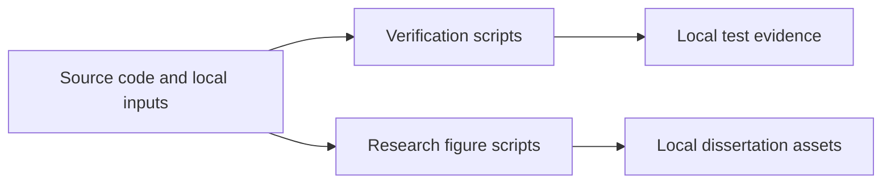

# Project scripts

Run commands from the repository root unless a script says otherwise. Scripts that need research CSVs use `backend/data/`, which is intentionally ignored by Git.

| Script | Use |
| --- | --- |
| `run-local-backend-tests.py` | Create a disposable local PostgreSQL test database, rehearse migrations and run backend tests |
| `test-postgresql.ps1` | PostgreSQL migration checks used by the documented test workflow |
| `lock-backend.ps1` | Regenerate pinned and hashed backend dependency locks |
| `production_smoke.py` | Check configured hosted routes when a deployment is intentionally available |
| `build_repository_graphs.py` | Score the installed legacy proxy model and export verified curves, counts, SVGs, PNGs and provenance |
| `build_dataset_excerpt.py` | Render a labelled excerpt from the actual local prepared Set A CSV |
| `build_dissertation.py`, `generate_dissertation_visuals.py` | Historical dissertation builders; their older Markdown source and diagrams are not the final edited Word draft |

The graph builders write into ignored `docs/dissertation/graphs-reproduced/`. Keep raw data, generated archives, local logs and draft Word files out of the public repository. See the [dissertation file guide](../docs/dissertation/README.md) and [testing guide](../docs/TESTING.md).
